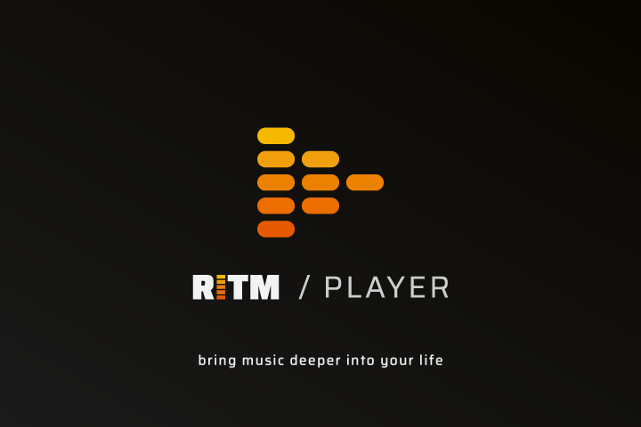

# RITM Player — Versi Basic

<p align="center">
  
</p>

Pemutar rilisan musik `.ritm` dan file audio biasa, dibuat oleh **rieproject.id | Arie Jakawiguna**.

Repositori ini berisi **versi basic** RITM Player untuk GitHub. Versi ini adalah pemutar inti tanpa fitur lanjutan. Untuk versi terbaru, installer, dan versi web, kunjungi:

**https://ritm.rieproject.id/**

---

## Perbedaan dengan versi lengkap

Versi basic ini sengaja dipangkas. Fitur berikut **tidak** ada di sini:

- Pengaturan audio: pilihan perangkat keluaran, mode exclusive / shared, buffer, resampler, dither, profil dengar, Peak Guard, dan info jalur sinyal. Pemutaran memakai mesin audio otomatis.
- Pencarian lirik daring (LRCLIB). Lirik hanya dibaca dari file `.lrc` di sebelah audio dan dari rilisan `.ritm`.
- Romanisasi lirik Jepang, Korea, dan China.

Fitur lain tetap lengkap, lihat bagian [Fitur](#fitur).

---

## Fitur

**Membuka musik**
- Membuka rilisan `.ritm` dan file audio biasa: MP3, WAV, FLAC, OGG, M4A, AAC.
- Membuka folder sebagai playlist. Metadata dibaca per file, dan file tanpa tag tampil dengan nama filenya.
- Seret file atau folder ke jendela, atau pakai Ctrl+O.
- Di Windows, file `.ritm` bisa dibuka langsung dari Explorer.

**Catalogue**
- Daftar rilisan yang terakhir dibuka. Rilisan yang masih diputar tetap tampil sampai pemutaran dihentikan.
- Tombol X menghapus rilisan dari daftar. Jika rilisan itu sedang diputar, layar utama dikosongkan setelah Stop.
- Tombol "Tampilkan di folder" membuka lokasi file di Explorer.

**Pemutaran dan tampilan**
- Lirik tersinkron. Klik satu baris untuk melompat ke waktunya. Lirik tampil di tengah layar, dan ketika lirik aktif, tampilan lain memudar.
- Booklet rilisan `.ritm` (maks. 5 halaman) dan galeri foto latar yang berganti selama lagu diputar.
- Animasi latar yang mengikuti musik, sesuai preset dari rilisan.
- Karaoke (versi instrumental) jika rilisan menyediakannya.
- Status integritas rilisan `.ritm`: terverifikasi atau tanpa tanda tangan.
- Layar penuh dengan tombol di header atau F11.
- Tema terang dan gelap, dua bahasa: Indonesia dan English.

**Pemutaran di Windows**
- Mesin native (WASAPI) dipakai secara otomatis jika tersedia, dengan keluaran bit-perfect.
- Jika mesin native tidak bisa memutar suatu berkas, pemutaran otomatis berpindah ke Web Audio dan melanjutkan dari posisi yang sama.

---

## Arsitektur

Repositori ini adalah monorepo dengan dua paket:

```
ritm-player/        Paket bersama (@ritm/player)
  src/format/       Format .ritm: pembaca arsip, verifikasi integritas, tanda tangan Ed25519, pengacakan audio, parser LRC
  src/engine/       Pemuatan media dan mesin Web Audio
  src/components/   Komponen pemutar: PlayerStage, LyricsView, BookletModal, TrackBackdrop, MoodCanvas, dll.
  src/i18n/         Teks Indonesia dan English

ritm-desktop/       Aplikasi RITM Player
  electron/         Proses utama Electron: jendela, dialog file, perpustakaan, pembacaan file yang diizinkan
  electron/preload  Jembatan IPC (contextIsolation dan sandbox aktif)
  native/           Mesin audio native (ritm-audio.exe, WASAPI) dan thumbnail Explorer (ritm_thumb.dll)
  src/              Antarmuka React: App, Library (Catalogue), TrackList, SettingsPanel, IntroAnimation
  public/           Aset PWA untuk versi web: manifest, service worker, ikon
```

**Teknologi**
- Electron untuk aplikasi Windows, dengan electron-builder untuk installer NSIS dan portable.
- React 19, Vite 6, dan Tailwind CSS 4.
- TypeScript di kedua paket.
- Format `.ritm` v1: arsip ZIP berisi `manifest.json`, `integrity.json` (SHA-256 per berkas), dan `signature.json` (Ed25519). Audio di dalam arsip diacak dengan skema xor-v1.
- Versi web dibuat dari sumber yang sama lewat `build:web`, dengan manifest dan service worker sehingga bisa dipasang sebagai aplikasi di HP.

**Alur pemutaran di desktop**
1. Renderer meminta file lewat IPC. Proses utama hanya membaca berkas yang pernah dipilih pengguna.
2. `ritm-player` memparsing rilisan dan memeriksa integritasnya.
3. Jika mesin native tersedia dan berkas punya lokasi di disk, `ritm-audio.exe` memutar audio. Jika tidak, Web Audio yang memutar.

---

## Cara membangun dari sumber

Syarat: Node.js 22.5 atau lebih baru, dan Windows 10/11 x64 untuk aplikasi desktop.

```bash
npm install

# jalankan aplikasi desktop dari sumber
npm run start:desktop

# aplikasi Windows tanpa installer (folder ritm-desktop/release/win-unpacked)
npm run dist:desktop:dir

# installer NSIS dan versi portable (folder ritm-desktop/release)
npm run dist:desktop

# versi web (folder ritm-desktop/release-web)
npm run build:web
```

Versi web bisa diuji dengan server statis biasa, misalnya `npx serve ritm-desktop/release-web`.

---

## Versi terbaru dan installer

Untuk mengunduh versi terbaru, installer, atau menjalankan versi web, buka:

**https://ritm.rieproject.id/**

---

## Hak cipta

© rieproject.id | Arie Jakawiguna
